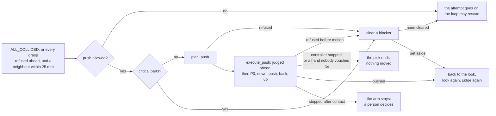

# Recovery (`src.robot.grasping.recovery`)

What to do after a pick failed: **look again**, or, on a wrist camera's pick in `dense_clutter`, **push the
part aside** or **set a blocker aside**, and look again. It plans; every motion it asks for still goes through
the same `RobotArm.move` and safety preflight as everything else, and nothing here asks a person anything.

There is no switch for it. Every cell built from config runs **the owner's recovery**, fixed on 2026-10-16 at
the values the owner's cell ran (`CELL_RECOVERY` in
[`autonomous_grasp/config.py`](../../execution/autonomous_grasp/config.py)): on in `auto` and `dense_clutter`,
a rescan once a pick, the push and the clearing of a blocker inside the pick attempt, at most two actions,
three tries at a blocker's grasp, a blocker set down where the parts go. A tree that still writes
`robot.grasping.recovery` is refused at load with the sentence that says to delete the block. What a task may
still choose for itself: the push distance (10 to 50 mm), whether a blocker goes into the place or aside,
whether it pushes and clears at all, and whether its parts are critical (`runtime.task.critical_parts` is the
cell's default).

Call it directly only to see what a failure class asks for:

```python
from src.robot.grasping import GraspFailureReason
from src.robot.grasping.recovery.orchestrator import RecoveryDispatcher

print(RecoveryDispatcher().actions_for(GraspFailureReason.MOTION_PLAN_REFUSED))   # (RESCAN,): never a motion
```

## The nouns

| Noun | Built by | Verb | Returns |
| --- | --- | --- | --- |
| `SceneRecoveryPolicy` | the pick service from its effective config (`CELL_RECOVERY`, or the run's own ticks) | `permits(action)` | `bool` |
| `RecoveryDispatcher` | `RecoveryDispatcher()` | `actions_for(reason)` | the actions the class asks for |
| `RecoveryOrchestrator` | the pick service | `next_step(context)` | `SceneRecoveryPlan`, or `None` to stop |
| a failed pick | the pick service | `run_recovery_loop(...)` | the final report and the recovery trail |
| a push | `plan_push(...)`, then `execute_push(arm, plan, gripper=, offer=)` inside the pick attempt | read | `PushPlan` or `PushRefusal`; then a `PushOutcome` |
| `PushCampaign` | the pick service, one per `PickRun` or console run (`start_campaign(push_mm=, critical_parts=)`) | `start_pick` | its `PushBudgets` (how many pushes are left), its `ExclusionZones` (the regions its task keeps out), its push distance and whether its parts are critical |
| `PushGate` | the pick service, for one pick the policy lets push | handed to the pick loop (`push_gate`) | nothing: without it nothing pushes |
| what a push came to | the pick loop (`pushes`) | read | `PickPush`: its code, its sentence, whether the arm left the look and whether it stopped |

## The actions

`NONE` is the typed "do nothing" and may not appear in an allow-list. Two actions are left:

| Action | What it does | Needs |
| --- | --- | --- |
| `RESCAN` | perceive again, moving nothing | nothing |
| `NUDGE_TARGET` | the push: the jaws move the part aside, inside a wrist camera's pick attempt | `dense_clutter` and a wrist camera; **no fixture** |

The first changes only what the cell knows; the second changes where things are. **The push needs no
envelope** (the owner, 2026-10-01): the automatic push box bounds where the part lands (*The plan*, below).
It needs no strategy either: it runs inside the pick attempt, where the part, its neighbours, the keep-out and
every look are known.

### What the service's loop does

The loop a cell built from config runs, driven by the pick service. Its outer gate is the mode's built-in
profile, which no run's ticks can widen:

| Mode | Its profile allows |
| --- | --- |
| `easy` | nothing |
| `auto` | `rescan` |
| `dense_clutter` | `rescan`, `nudge_target` |

- **The loop plans `rescan` alone.** It moves nothing itself: the next pick perceives and ranks afresh. A
  wrist pick handed looks gets no recovery rescan: its looks and its one generated view were its rescans, so
  a rescan never repeats them, and an INFO line says so. A wrist pick handed no look and a fixed camera rescan
  where they stand. No re-pick drives a look again, so a toggle's count is asked about only where every pick
  asks it: in its own check before the arm moves.
- **`nudge_target`** is the push, which runs inside a wrist camera's pick attempt (below). The loop never
  plans it.
- **A task keeps regions out** of its picks for its whole length (`ExclusionRegion`, a turned rectangle or a
  circle, for one label or every label, kept until `forget_regions()`, or `forget_region(region)` forgets one
  alone): the bin it places into, its footprint grown by 10 mm, and 150 mm about a pose drop for "until
  empty", laid only where the arm's own kinematics say where the pose puts the tool. A check of one bin of a
  sort replaces that bin's region alone (`forget_region`, the owner, 2026-10-09), so every other rule's bin and
  every taught drop stay kept out. `applies(label)` says whether a region applies, the empty label included,
  and the pick loop skips such parts. A look that saw only parts a region kept out stops with a sentence, and
  it is an empty look for the task (`only_excluded`).
- **The end.** `terminal_outcome_for_trail` names what a finished loop stands for, and the service sets it:
  `recovery_exhausted` where a rescan ran and none was left. A pick that found nothing keeps `no_target`, and
  one that ended on a stopped controller, a gripper fault, a push that stopped or a fault of the cell keeps its
  own. Otherwise the last pick's own outcome stands.

`NEXT_VIEWPOINT` was merged into `RESCAN` on 2026-09-29: with the viewpoint planners gone nothing moved the
camera for it, so it re-perceived exactly as `RESCAN` does. `NEXT_TARGET`, the rescan that skipped the part a
pick failed on for a few picks (its exclusion zones with it), and `CONTAINER_AGITATE`, a bounded shake inside a
declared fixture box (`FixtureEnvelope`, `ContainerAgitateStrategy`, `execute_recovery_motion`), left on
2026-10-16 with the `recovery` block (the owner's cleanup): the owner's cell agitated nothing, and a pick takes
the first part whose best grasp is good, the push and the clearing of a blocker beside it. A run that still
names one of the three is refused with the sentence that says what to use instead; a record logged before then
keeps its strings. The strategies left with them: `SmallNudgeStrategy`, a blind +X offset from wherever the arm
stood, had already left with the push that replaced it.

## The push

A clutter jam is the one case a push is for. The hand closes in the air over the part, a Robotiq to its
closed width (the owner, 2026-10-15) and a toggle by one change of DO0 (2026-10-16), and the **closed
fingers**, about 22 mm across where the open Hand-E stood 72, move the failed part away from the neighbours
that blocked the grasp. At the look after the push the hand opens again, a toggle by one more change of
DO0, and the pick looks again. Any other hand keeps its jaws open, and the outer face of the leading finger
pushes. Nobody is asked anything on the way. The push runs **on a wrist camera's pick only**, after its
looks judged the part: a fixed-camera cell never pushes.

**The push may rearrange the scene** (the owner, 2026-10-03: "Er darf die Szene ruhig dolle verändern"):
the part may shove what stands in its way, and the fingers may brush what stands beside their stroke. Only
**critical parts** are spared that. One switch says which parts a cell handles, `runtime.task.critical_parts`
in `app/runtime.yaml`, and a console run can set it for itself (*Kritische Teile* in the Advanced drawer):

| `critical_parts` | A part every grasp of which collided, or every grasp of which was refused ahead |
| --- | --- |
| `false`, the default | pushed first, and the push may rearrange the scene; where no push plans, a blocker is cleared |
| `true` | never pushed; a blocker is cleared ([`blocker.py`](blocker.py), run by [`loop/`](../loop/README.md)) |



**When.** No candidate survived and at least one collided (`ALL_COLLIDED`); or every grasp of the part
was judged from the look and refused there, so nothing moved (`grasps_refused_ahead`: the joint window,
the planner, URSim 2026-10-03). In each case a neighbour was seen within 25 mm of the part
(`neighbour_evidence`, on the neighbour clouds of every look). Never on `NO_VALID_GRASP` or
`NO_CANDIDATES_GENERATED`: nothing there says a neighbour is in the way. The geometric and the deep
calculator both trigger it.

**Allowed.** `push_permitted(profile, policy)`: recovery on and the mode in `apply_modes`; `dense_clutter`,
the one profile that lists `nudge_target`; the cell's actions, or the run's own ticks, name it; neither
`max_recovery_actions` nor its `per_action_budget` is zero. The same gate lets the pick clear a blocker,
and it pushes only where the parts are not critical (the run's `critical_parts`, else
`runtime.task.critical_parts`). **No fixture needed**: the automatic push box alone bounds it. The service
then hands the pick a **`PushGate`** where it could read the cell's push inputs (`PushCell`: the registry
hand, the workspace, the hand's clearance, a declared container) and the campaign has a distance; a WARNING
says once why a permitted cell cannot push. The **budgets** come on top: 1 push per part, 2 per pick, 5 per
campaign (`PushBudgets`). A part pushed once is the same part within 30 mm plus the push length of where it
stood. A spent budget means no more pushes, never a stop.

**Before the plan**, the pick loop reads, cheapest first: an attempt left to pick the part from afterwards
(`refused_no_attempt_left`, so a service built with `max_attempts=1` never pushes), the part's points (`refused_no_target_points`),
a resolved support (`refused_no_support`), a neighbour within 25 mm (`no_blocking_neighbour`), the plan, the
budgets (`part_already_pushed`, `pick_budget_spent`, `campaign_budget_spent`) and the joints to come back to
(`refused_joints_unknown`). Each is no push, and the attempt goes on.

**How far.** 30 mm unless asked otherwise (`push_mm` on `PickRun` and on the console's pick request), 50 mm
at most: the owner's numbers of 2026-09-29 (`DEFAULT_PUSH_DISTANCE_MM`, `PUSH_DISTANCE_CAP_MM`), every cell's
since 2026-10-16. A request up to 50 mm is taken as asked; above it, or under 10 mm, it is refused with a
sentence, never shortened (`resolve_push_distance`): `PickRun` refuses as it is built, before any pick; the
console answers `422 push_distance_refused` and starts no run. Where nobody asked and no direction frees the
part at 30 mm, the planner tries longer pushes in 10 mm steps up to 50 mm, the shortest that works first: 30,
40, then 50 mm. A distance a person asked for is never lengthened.

**The plan** (`plan_push`, pure numpy in BASE millimetres):

- **The hand** comes from the gripper registry (`push_hand.py`): the fingers of the cell's jaw and the
  housing's thickness, `palm_thickness_mm`, 75 mm on the Hand-E. A cell that names no hand, or carries no
  parallel jaw, plans no push.
- **The direction.** Each offered axis is tried both ways, at 0, 45, 90 and 135 deg. The part's
  clearance to its neighbours must grow by at least 10 mm, a neighbour it shoves counted where it ends, so
  a push that only drives a neighbour along in front of the part is refused. A push that touches nothing
  but the part comes first; among the rest, the largest gain wins.
- **The rearranging push** (`may_shove`, the pick's push wherever it pushes). The fingers come down 10 mm
  from every neighbour (`BESIDE_THE_PART_CLEARANCE_MM`), on table the camera saw. The housing keeps the
  camera world's margin plus its line clearance (25 mm with the shipped values) from every neighbour tall
  enough to reach its underside, all along the stroke, and such a neighbour stays in the guard's world:
  the fingers keep the same clearance from it. Contact is allowed with what stands lower: a neighbour in
  the stroke's corridor is shoved ahead to where the part's front ends, one beside the fingers' stroke may
  be brushed. Every neighbour the push may touch is held out of the camera world **whole**, a box of its
  own beside the part's (`PushPlan.kept_out_neighbours_mm`), as the world joins it on its 25 mm grid: a box
  round the stroke alone left the rest of a 60 mm block for the world to box again, and the guard refused
  the push leg at 4.5 mm (URSim, 2026-10-03). What it shoves must land, like the part, on table the camera
  saw, away from its edge. Nothing is pushed over an edge.
- **The careful push** (`plan_push`'s default, for a caller that plans one itself). The swept open hand
  keeps the camera world's margin plus its line clearance from every neighbour point, so the planner plans
  no push the line judge's clearance check would refuse; the judge can still refuse a line for other
  reasons (*A stop*, below). Beside the pushed part it keeps 10 mm (the owner's decision of 2026-10-02): a
  neighbour point inside the box the push keeps out of the camera world round the part and its path (the
  smallest rectangle about them, as the world boxes a target, grown by the world's margin) is one the
  guard does not see while the push runs. The part's own path keeps 5 mm from every neighbour point not
  behind it.
- **The height.** The part must rest on the support: its base, the 2nd percentile of its heights, at most
  10 mm above it. Where it lies higher, no look saw the part's foot (from above alone, or past a neighbour
  that hides it), and the foot is **inferred** (the owner, 2026-10-03: "Allgemein Schieben erlauben,
  sofern nicht ein Abgrund oder so da ist"): the part stands on the support where the ring within 15 mm
  round its footprint holds no edge of what the camera saw, at least a quarter of that ring is the support
  itself (parts side by side can pass for the ground), and the camera saw no table under the part. Else
  `part_not_on_support`; inside a declared container no foot is inferred. The plan says `foot: inferred`.
  No push for a part under 15 mm of its own height, none for one that reaches within 5 mm of the palm's
  underside (`part_reaches_the_palm`), and none on a support tilted more than 5 deg. The fingertip rides
  at support + clamp(own height / 2, 10, 20) mm, and never under the **finger floor**: over a surface the
  camera world holds as a solid, the solid's top along the hand's sweep plus the guard's distance plus 1 mm
  (`finger_floor_mm`); a push whose finger would pass over the part there is refused
  (`refused_finger_floor_over_the_part`). The support is the surface the part stands on, read on its own
  local plane, where the camera world found one (`SupportModel.surface_under`, its `table_points`).
- **The workspace.** Every TCP point of the push stays 20 mm inside every face of the workspace box,
  `z_min` included. The finger rides 10 to 20 mm over the table, so a `motion.workspace.z_min` set well
  above the table refuses every push: the base tree's 100 mm does, for a table at base Z 0. Check it on
  the cell.
- **The push box.** With no container, the extent of the surface the part stands on where the camera world
  found one, else the workspace box intersected with the table the camera saw, shrunk by 30 mm (no longer
  by the push as well: how far a part travels does not move the edge it must keep away from); with a
  declared container, its interior. This box alone bounds the push: the fixture box that could narrow it left
  on 2026-10-16. The predicted landing plus 15 mm stays inside. The seen table is kept as 5 mm cells in
  BASE XY: a cell is seen where a table point falls in it, or the part or a segmented neighbour stands on
  it. An unseen patch that seen cells enclose is ground as well: beside something standing it is its
  shadow, whatever its size, and elsewhere where it spans at most 50 mm each way (a dip of the mat). A
  larger one may be a hole, and an unseen patch that reaches the edge of what was seen is that edge. Every
  cell within 45 mm of each landing point, the part's and every shoved neighbour's, must be seen or ground,
  and every cell under the fingers must be seen: their whole stroke on the careful push, where they come
  down on the rearranging one. The housing rides at least the finger's length higher and needs no table
  under it. A hole, a gap or a diagonal table edge refuses that direction, and fewer than 100 seen cells
  near the part refuses the push (`no_table_seen`).

**Before anything moves** (`execute_push`), each of these is read, and none asks anybody. The first that
fails is a `refused_*` outcome with zero motion, and the attempt goes on as if no push had been due. Two end
the pick instead, with nothing commanded: a controller that cannot move or cannot be read
(`controller_not_operational`, as a stopped controller ends a pick anywhere), and a hand nobody can vouch for
(below).

| Checked | Refused as |
| --- | --- |
| a `PushPlan` whose legs keep the owner's speeds: down, back and up at 50 mm/s, the push at 25 mm/s, 0.1 m/s² | `refused_no_plan`, `refused_leg_too_fast` |
| the shape of a push, whoever built it: 10 to 50 mm, at most 5 deg off straight down, P0 80 mm above the contact start, a 10 mm contact gap, 5 mm back, 80 mm up, each station within 1 mm | `refused_push_too_short`, `refused_push_too_long`, `refused_plan_malformed` |
| an arm with the typed `move` that judges every straight line (`LineMotion.CHECKED`), and its live camera world | `refused_no_typed_move`, `refused_lines_not_judged`, `refused_no_live_world` |
| the part's points on the offer, and the plan's part inside their footprint plus 5 mm | `refused_no_target_points`, `refused_offer_not_the_part` |
| on an arm that judges lines ahead (`JudgesLinesAhead`, the UR driver): the move to P0 and every leg, judged from where the arm stands, each from where the one before ends, with the part and every neighbour the push may touch held out of the world | `refused_ahead` |
| a controller that can move | `refused_controller_stopped` |
| a connected hand whose jaws stand open: a toggle's count says open (`jaws_closed` false, `why_jaws_unknown()` empty), a hand that measures its width reads within 2 mm of fully open | `refused_no_gripper`, `refused_jaws_closed`, `refused_jaws_unknown` |
| the arm at rest, as before every motion (5 s at most; `safety.dwell` until 2026-10-17) | `refused_arm_not_steady` |

A count that says **closed** means no push, and the attempt goes on. A count **nobody can vouch for**
(DO0 switched at the pendant since the pick began, the count lost at a failed change or a disconnect, or
its output unreadable) **ends the pick as a gripper fault**, as the toggle's own refusal ends one (the
owner, 2026-09-30): nothing more moves, the report's `gripper_fault` says why, and `PickRun` and the console
run stop on it. So does a gripper that measures its width (the Robotiq socket driver) found **not
connected** there, or whose width read fails: that driver counts itself connected until the program
disconnects it, so a socket that stopped answering shows as a read that fails. Nobody is asked either way:
`jaws_open_for_a_pick`, which can ask a person, is never called. A connected width that reads short of open
is no push, and a gripper that neither counts nor measures never says its jaws stand open: both are plain
refusals.

**The motion.** Inside `keeping_out`, with the part and its swept travel held out of the world, and every
neighbour a rearranging push may touch as a box of its own (`refused_keep_out_not_taken` where the world
does not take them), the whole push is judged ahead first (`refused_ahead`, nothing sent). Then P0 in the
air above the contact start,
like a grasp approach (the arm's plain `move`: the straight joint line first, a capped cuRobo detour only
where the line is blocked); then down, push, back 5 mm and up, each a judged straight line
(`move(pose, linear=True, vel=, acc=)`) at the plan's speed, the controller read, a toggle's count read
again and the arm's rest waited for before each. Every pose closes the way round nearer the cell's
`robot.motion.natural_closing_axis` where it names one (`push_tool_quaternion`, as every camera grasp), else
nearer where the tool stands. The controller and a toggle's count are read once more after the up leg:
either one failing there stops the arm at the lift point. Then the arm goes back to the look like a grasp
approach (to the one view the pick generated, on the straight joint line alone), the pick's target is
offered to the world again, what the earlier looks saw of the part leaves their views,
and the pick looks again, fused with its earlier frames, and judges again. A stop asked for while the
push was planned moves nothing (`refused_stop_requested`): the next attempt, or the recovery's next pick,
ends `cancelled` before it moves.

**A stop.** A P0 refused before anything was sent (`refused_approach_not_sent`) moved nothing and falls
through. So does a **down leg refused before it was sent** (`refused_down_not_sent`), the arm still in the
air at P0: it goes back to the look like a grasp approach first, and the round trip counts against the
budgets. That fall-through is the lead's ruling of 2026-09-29, pending the owner. "Before it was sent" is
the one rule a look uses too: a guard or the planner refused (`REFUSED_BEFORE_SENDING`), or the planner
found no plan. A down leg refused with a status not known as "nothing sent" (`unsupported`,
`connection_error`, `controller_rejected`) may have been commanded, and **stops**: safe, and how often
it happens is for URSim to measure. Once anything else may have moved, nothing more moves: a leg
refused or failed, a failed move back to the look, a controller that cannot be read, a toggle's count
nobody can vouch for before a contact leg or once the arm is up (DO0 switched while the push drives), or an
arm not at rest is `unsafe_recovery_refused`, and a controller that says it cannot move, a protective stop, is
`controller_not_operational`. The arm stays where it stopped: no planned escape, no automatic recovery
(`acknowledge_fault` is never called). A `CameraWorldUnavailable` on the way is raised out, as
on every motion of a pick, and its report carries the stopped push too.

The report then **needs a person** (`needs_person`), the campaign ends, and the service **refuses every
pick** (`unsafe_recovery_refused`, nothing asked, perceived or moved) until a new `PickRun` or console run
starts, or a program calls `acknowledge_needs_person()`. **Clear the cell first**: that run's first pick
drives the arm from wherever the push left it to its first look.

**What it records.** The attempt's action `push` and its `push` code, every push the pick considered in
`telemetry['pushes']` (with the plan's `finger_height_mm` and `landing_box_xy_mm` and every motion's
`leg_verdicts`, which robot.log says too) and a stopped one's sentence in `telemetry['push_stopped']`, and a
`nudge_target` row in the record's `recovery_actions` for every push whose arm left the look (`plan_reason`
`push_in_the_pick`, `recovered_success` on the last row where the recovery ended in a success). The trail's
actions never list a push. All of it is additive.

## Every gate a rescan passes

The loop plans a rescan only when all of these hold; otherwise it stops.

- The policy is enabled and the resolved mode is in its `apply_modes`.
- The attempt has not used `max_recovery_actions`, and the rescan is within its `per_action_budget`.
- The mode's behaviour profile lists it in `recovery_allowed_actions`, and the policy lists it too.
- It has not already been tried for the same failure class (`RecoveryHistoryEntry` records the pairs).

`easy` never recovers, twice over: its profile allows no action, and it is absent from the cell's
`apply_modes` (`auto`, `dense_clutter`). The push has a gate of its own, `push_permitted` (*Allowed*, above).

## Failure class to action

`RecoveryDispatcher` maps each `GraspFailureReason` to the actions it asks for. Every class a look again can
help asks for `rescan`: reach and table conflicts, perception complaints, occlusion, `NO_CANDIDATES_GENERATED`,
`ALL_COLLIDED` and `NO_VALID_GRASP` (the push ran inside the attempt before it failed), and the refinement
classes an older record may carry. Two entries are rules rather than tuning:

- `MOTION_PLAN_REFUSED` maps to `rescan` and nothing else, never an action that commands motion: moving
  after the cell declined to move is how a refusal becomes a motion. The next pick's motion is judged whole.
- `CONTROLLER_NOT_OPERATIONAL` maps to nothing: a stopped cell needs a person, not a retry. So do
  `TARGET_LABEL_NOT_FOUND`, `TOPOLOGY_RISK_REJECTED`, `SEMANTIC_REJECTED`, `TRY_NEXT_CANDIDATE` and
  `DEFORMABLE_ROUTING_REQUIRED`.

## What it refuses

| Refusal | When | What to do |
| --- | --- | --- |
| refused at load | a tree that still writes `robot.grasping.recovery` (or `dense_recovery`, removed 2026-09-29) | delete the block: every cell recovers as the owner's did, and `runtime.task.critical_parts` holds the one choice that stayed with the cell |
| `ValueError` from the service | a run, or a hand-built snapshot, that names `next_target`, `container_agitate` or `next_viewpoint` | name `rescan` (and `nudge_target` for the push), as the sentence says |
| `ValueError` from `SceneRecoveryPolicy` | `NONE` in `allowed_actions`, a duplicate, a plain string, or a negative budget | fix the list |
| a push distance refused (`422 push_distance_refused` on the console) | asked above 50 mm or under 10 mm | ask 10 to 50 mm |
| push `refused_controller_stopped`, pick `controller_not_operational` | the controller could not move, or could not be read, before the push | nothing moved; a person clears the stop where the arm is visible |
| push `refused_jaws_unknown`, pick `gripper_fault` | nobody can say where a toggle's jaws stand when the push reads the count, or a width-measuring gripper is not connected or its width read failed | nothing moved; look at the jaws, then connect again: a toggle's connect asks where they stand, and a width gripper is reconnected |
| push `unsafe_recovery_refused`, `controller_not_operational` | a push stopped once anything may have moved | the campaign ends and the service refuses every pick until a new run starts; clear the cell first |

## Traps

- A push needs the table seen around the part, 45 mm round each landing. A shadow or a dip among seen
  table counts as ground, the edge of what was seen never does: give the pick looks that see past the part,
  or declare a container. A part whose lower side is hidden is taken to stand where the table round it says
  so, and fails closed where it does not (`part_not_on_support`).
- `critical_parts: true` means no push at all. The clearing it leaves has a window: a neighbour within about
  31 mm leaves the Hand-E's part no grasp, and one within about 20 mm leaves the hand no room to grip that
  neighbour either, so a part boxed in that tightly stays boxed (URSim, 2026-10-03: an L of two 30 mm blocks
  8 mm from a 30 mm block was cleared by nothing; 28 mm away, one block was set aside and the part picked).
- The push reads a toggle's count before P0, once its plan and budgets passed, again before each contact
  leg and once the arm is up. DO0 switched on the way back to the look, or before a rescan, goes unseen until
  that pick's own check before the approach (`PickRun` asks, a console run stops). Keep hands off the
  pendant's tool outputs while a pick runs.
- During the push the keep-out takes neighbour points out of the world well beyond the part's path: up
  to about 21 mm for a push along a BASE axis, about 36 mm for a diagonal 50 mm push, and every neighbour
  a rearranging push may touch, whole. The planner's clearances guard the hand there, and its hand model
  carries neither the wrist camera nor the coupling: what is held out of the world is judged by the
  planner alone.

## Status

| Capability | Evidence |
| --- | --- |
| The recovery loop | measured in simulation: `run_dense_pick --recovery` drives the service's loop |
| The push planner, the budgets and the regions a task keeps out | pinned by tests on synthetic scenes; never touched hardware |
| The push motion | pinned by tests: a fake arm and a fake live world record every call, and the owner's toggle Hand-E runs as a real `JawIOGripper` on fake I/O; ran on URSim CB3 on 2026-10-02 and 2026-10-03 with the owner's Monday tree and a stand-in camera that casts the bench and the recorded look ([`probe_push_on_the_mat.py`](../../../../scripts/ursim/probe_push_on_the_mat.py)): a rearranging push of a cylinder beside a 60 mm block, a blocker of an L cleared for a critical part, a stop and a protective stop mid-push; not yet in Isaac; never touched hardware |

## Files

| File | Holds |
| --- | --- |
| `policy.py` | `SceneRecoveryAction`, `SceneRecoveryPolicy`, `SceneRecoveryContext`, `SceneRecoveryPlan`, `push_permitted`, `refused_before_motion` |
| `orchestrator.py` | `RecoveryDispatcher`, `RecoveryOrchestrator`, `run_recovery_loop`, `terminal_outcome_for_trail`, `RecoveryHistoryEntry` and the trail |
| `push_planner.py` | `plan_push`, `PushPlan`, `PushRefusal`, `PushHand`, `resolve_push_distance`, `neighbour_evidence`, `table_points_from_cloud`, and the owner's numbers as named constants |
| `push_hand.py` | the push's hand: the cell's jaw and the registry's `palm_thickness_mm` |
| `push_motion.py` | `execute_push`, `PushOutcome`, `PushOutcomeCode`, `push_tool_quaternion`, `neighbours_kept_out` |
| `push_gate.py` | `PushGate`, `PushCell`, `PushCampaign`, `PickPush`, `support_points_of_views`: what the service hands a pick, what a campaign keeps, what a push came to |
| `push_budgets.py` | `PushBudgets`: 1 push per part, 2 per pick, 5 per campaign |
| `exclusion_zones.py` | `ExclusionZones` and the `ExclusionRegion`s a task keeps out for its whole length |
| `blocker.py` | clear the blocker: `clusters_of`, `not_a_blocker`, `support_seen_round`, `mask_of`, `free_spot`, `release_pose`, `taught_place`, `BlockerRecord` and its codes ([`loop/`](../loop/README.md) runs it: for critical parts in place of the push, for the others where no push plans) |

## Details

- [`loop/`](../loop/README.md) reports the failure this package reacts to, runs the push inside the
  attempt and skips the parts a task keeps out; [`types/`](../types/README.md) holds `GraspFailureReason`.
- `closed_loop/` held the other second chance, the two-scan refinement taken before the failure; it
  was removed on 2026-09-29.
- [`safety/`](../../safety/README.md) holds the guards every push waypoint still passes.
- [The grasping config reference](../../../../docs/grasping-config-reference.md) for the modes the recovery
  runs in.
- Tests: `tests/test_grasp_recovery.py` (the policy and the push gate), `tests/test_t5_recovery_dispatcher.py`,
  `tests/test_t5_recovery_orchestrator.py`, `tests/test_t5_service_retry_loop.py`,
  `tests/test_a_config_built_recovery_plans_only_what_its_profile_allows.py` (the owner's recovery on a cell
  built from config), `tests/test_a_rescan_is_the_only_second_look.py`,
  `tests/test_a_push_is_planned_from_what_the_camera_saw.py`, `tests/test_the_push_budgets.py`,
  `tests/test_a_push_moves_only_when_every_guard_holds.py`, `tests/test_a_push_takes_its_hand_from_the_registry.py`,
  and end to end on the owner's cell in miniature: `tests/test_a_boxed_in_part_is_pushed_inside_the_pick.py`,
  `tests/test_a_push_and_its_re_pick_leave_the_toggle_alone.py`, `tests/test_api_pick_push_distance.py`,
  `tests/test_a_push_needs_no_fixture.py` (the automatic push box alone),
  `tests/test_a_jaw_count_nobody_vouches_for_moves_nothing_more.py` (the contact legs and the lift point, a
  width gripper not connected or unreadable, a pick whose count went unknown at its last look) and
  `tests/test_a_part_the_axis_refused_is_never_pushed.py` (the closing axis and the natural orientation
  beside the push). The owner's rules of 2026-10-03: `tests/test_a_push_may_rearrange_the_scene.py` (the
  inferred foot, the ground, the longer push, the rearranging push, the whole neighbours held out, every
  line judged ahead, the switch), `tests/test_clearing_reaches_what_a_look_from_above_hides.py` and
  `tests/test_api_a_task_says_its_parts_are_critical.py`.
